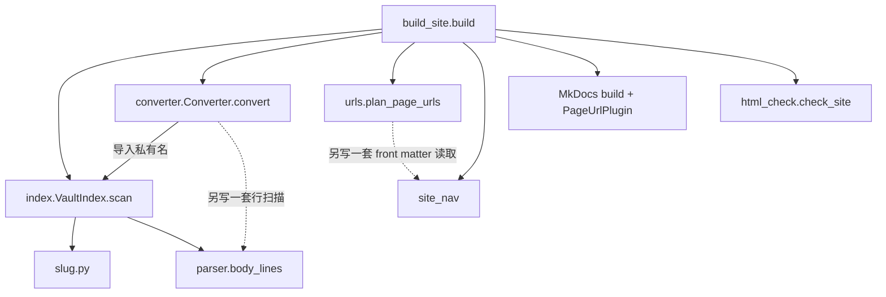

# 架构评审与轻量化重构方案

本文是交给重构 Agent 的任务说明：先讲清现在的模块结构，再给出按顺序执行的瘦身步骤，每一步都写明证据、做法和验收方式。**本文写作时没有修改任何代码。**

## 评审基线

- 日期：2026-10-16
- 基线：`6e1fed5`。构建代码与 v2.1.0（`7177336`）相同，之后只有内容提交。
- 范围：`tools/`、`tests/`、`mkdocs.yml`、`theme/`、`overrides/`、`docs/javascripts/`、CI，以及仓库根目录的非内容文件。不评审 `docs/` 里的笔记内容和 `.claude/skills/` 的内容本身。
- 已执行的验证（Python 3.14.4，在临时 venv 中按 `requirements.txt` 安装依赖）：
  - `python -m unittest discover -s tests`：46 个测试通过。
  - `python tools/build_site.py`：构建成功。
  - F1–F3 用脚本复现。
  - `slug.py` 与 Markdown 库的对比：917 个标题，结果全部一致。
  - 用 MkDocs 链接校验代替 `html_check.py` 的试验：小样例能拦下错误，真实仓库构建通过。

## 结论：臃肿在哪里

| 部分 | 现状 | 判断 |
| --- | --- | --- |
| `.claude/skills/` | 56 个文件，636 KB，是中央技能库的副本 | 仓库里**最大的一块非内容文件**，和网站无关 |
| 根目录 `.obsidian/` | 4 个文件，`app.json` 内容是 `{}`，`workspace.json` 也提交了 | 误把仓库根目录当 Obsidian 仓库打开时留下的，真正的仓库配置在 `docs/.obsidian/` |
| `tools/` | 12 个 .py 文件，约 1,580 行 | 总量不算大，但有**重复实现、可以交给依赖库的代码、死代码**，见下文 |
| `tests/` | 4 个测试文件，约 730 行 | 合理，是重构的安全网，不要削减 |
| 前端 | `theme/` 1 个、`overrides/` 3 个、`docs/javascripts/` 3 个 | 量很小，问题只是 JS 放进了 Obsidian 仓库 |
| `开发文档/` | 4 个文件 | 正常 |

所以轻量化的重点有两个：一是**仓库杂项**（文件数量的大头），二是 `tools/` 里**同一件事写了好几遍**。构建代码并没有严重过度设计，不需要推倒重写。下面的步骤**只删除、合并，不新增模块和子包**。

## 现有模块结构

| 模块 | 文件（行数） | 实际职责 |
| --- | --- | --- |
| 构建编排 | `tools/build_site.py`（200） | 站点配置常量、清理输出、调用各阶段、附件发布规则、复制 CSS、生成列表页、调用 MkDocs、跳转页、HTML 检查、源文件哈希比对 |
| 仓库索引 | `obsidian_compat/index.py`（194） | 扫描 `docs/`，记录页面（标题锚点、块 ID）和附件，查找双链的候选目标 |
| 行扫描 | `obsidian_compat/parser.py`（96） | `body_lines` 跳过 front matter、代码块和公式块；残留语法检查 |
| 转换 | `obsidian_compat/converter.py`（540） | 块级和行内转换、引用解析、诊断、松散列表补空行、是否公开的判断 |
| 网址 | `obsidian_compat/urls.py`（157） | 读 slug、分配网址、MkDocs 插件、中文旧路径跳转页 |
| HTML 检查 | `obsidian_compat/html_check.py`（107） | 检查生成 HTML 中的链接、锚点、残留标记 |
| 标题 slug | `obsidian_compat/slug.py`（42） | 手写复刻 Python-Markdown 的标题锚点规则 |
| 类型和诊断 | `models.py`（67）、`diagnostics.py`（14） | 数据类和诊断输出 |
| 导航 | `tools/site_nav.py`（155） | 用 YAML 读 front matter，生成文章列表页、首页最近文章和导航树 |



实线是调用，虚线是本该共用、却各写了一份的逻辑。没有依赖环。

## 已确认的问题

这些问题是“同一件事写了几遍”造成的直接后果，在瘦身时顺手修掉。

- **F1 公式块里的列表行会被插入空行。** `_normalize_loose_lists`（`converter.py:88`）只跳过代码块，不跳过 `$$` 公式块。输入 `text\n$$\na\n- b\n$$`，输出里 `a` 和 `- b` 之间多了一个空行。现有笔记没有触发。
- **F2 未闭合的 front matter 有两种解释。** 遇到 `---\ntitle: x\n# H\n[[missing]]` 时：`body_lines` 把整篇当正文，`Converter.convert` 把整篇当 front matter。结果坏链接报的是 `E_RESIDUAL_OBSIDIAN`，而不是 `E_LINK_MISSING`。
- **F3 slug 和其他元数据用两套解析器。** `urls.front_matter_slug`（`urls.py:26`）逐行用正则，`site_nav.read_meta`（`site_nav.py:33`）用 YAML。`slug: abc # note` 被正则读成 `abc # note` 并报错，YAML 读成 `abc`。front matter 未闭合时，正则能读出 slug，YAML 读不到。
- **S1 “是否公开”的规则写了 4 处：**
  - `Converter.is_unpublished`（`converter.py:129`）
  - `build()` 的发布计数（`build_site.py:188`）
  - `test_site_nav.py:147`
  - 附件发布规则（`build_site.py:104-106`），这一处没有单元测试
- **S2 死代码：**
  - `ResolvedTarget`
  - `PageRecord.logical_path`、`file_name`，以及 `_by_logical`（只写不读）
  - `output_path`，在两种记录里都恒等于 `source_path`
  - `obsidian_compat/__init__.py` 的导出没有人使用
- **S3 重复常量：**
  - `_BLOCK_RE` 在 `index.py:14` 和 `converter.py:14` 各一份。
  - 残留语法正则在 `parser.py:8` 和 `html_check.py:11` 各一份。
  - `converter.py:8` 导入了 `index` 的私有名。
- **S4 JS 放在 Obsidian 仓库里。** `docs/javascripts/` 被索引当作“附件”复制到网站，CSS 却在 `theme/`。

## 重构步骤

按顺序执行。每一步单独提交，提交前跑完“每步通用验收”。

### 第 0 步：建立基线快照（必须先做）

在**修改任何代码之前**运行：

```bash
python tools/build_site.py
```

```bash
(cd site && find . -type f | sort) > /tmp/site-files.before && cp -r .cache/converted-docs /tmp/converted.before
```

之后每一步都重新构建，并与基线对比：

```bash
(cd site && find . -type f | sort) | diff /tmp/site-files.before -
```

```bash
diff -r /tmp/converted.before .cache/converted-docs
```

**每步通用验收**

1. `python -m unittest discover -s tests` 全部通过。
2. `python tools/build_site.py` 成功。
3. 网站文件清单与基线一致，除非这一步本来就要改变它。
4. 转换后的 Markdown 与基线一致，除非这一步本来就要改变它。
5. `site/tech/subscribe-claude-quick/index.html` 存在。

环境说明：系统 Python 可能缺少 `mkdocs-material`，要先按 README 建 `.venv`。需要 Python 3.13 以上。

### 第 1 步：清理仓库杂项（需作者确认，见文末）

- 删除根目录 `.obsidian/`（4 个文件）。不要碰 `docs/.obsidian/app.json`，测试依赖它。
- `.claude/skills/` 改为不跟踪：`git rm -r --cached .claude/skills`，并在 `.gitignore` 加上 `.claude/`。本地文件保留，Agent 照常可用。
- 验收：通用验收；`git ls-files | wc -l` 少约 60 个。

### 第 2 步：删除死代码（S2、S3 的一部分）

- 删除上文 S2 列出的全部死代码。`PageRecord` 只保留 `source_path`、`headings`、`block_ids`；`AttachmentRecord` 只保留 `source_path`。所有用到 `output_path` 的地方改用 `source_path`。
- `obsidian_compat/__init__.py` 清空，只保留一行文档字符串。
- 把 `diagnostics.py` 的 `emit_diagnostics` 并入 `models.py`，然后删除 `diagnostics.py`。
- 预期：转换结果和网站文件都与基线完全一致。

### 第 3 步：`slug.py` 改用 Markdown 库

- 证据：对仓库全部 917 个标题，`markdown.extensions.toc.slugify(text, "-")` 配合 `unique()` 的结果，与 `unique_toc_slugs` 完全一致。提交 `a22ea89` 修过一次手写版和库不一致的缺陷，改用库就不会再出现这种偏差。
- 做法：把 `visible_text`（去掉双链、链接、强调、HTML 标记的那部分）移进 `index.py`，标题锚点直接调用库函数，然后删除 `slug.py`。
- 预期：转换结果和网站文件都与基线完全一致；`test_compat.py` 中重复标题的测试仍然通过。

### 第 4 步：用 MkDocs 自带的链接校验代替 `html_check.py`

- 证据：
  - 在 `mkdocs.yml` 加上 `validation: {anchors: warn}` 后，严格模式下 MkDocs 能拦下缺失的页面、缺失的图片、不存在的标题锚点和块锚点。块锚点 `<a id="^x">` 能被识别。
  - 用这个配置构建真实仓库，并跳过 `check_site`：构建通过。
  - 源文件层面的双链和锚点错误本来就由 `converter.py` 检查，残留语法由 `parser.residual_diagnostics` 检查。
- 做法：
  - 在 `mkdocs.yml` 加上 `validation` 配置。
  - 删除 `html_check.py` 和 `build_site.py` 中对它的调用。
  - `write_redirects` 返回的冲突诊断照常处理。
- 会失去的检查：跳转页和主题模板里的链接不再被检查。跳转页由代码生成，已有 `test_urls.py` 覆盖，可以接受。
- 新增测试：在临时目录里放一篇含坏锚点的已转换 Markdown，确认 MkDocs 严格构建会失败。这条测试用来确认上面的配置确实有效。
- 预期：网站文件清单一致。

### 第 5 步：行扫描和 front matter 只保留一份（修复 F1、F2、F3）

- 在 `parser.py` 中提供**唯一**的行分类：把每一行标为 front matter、代码块、公式块或正文。
  - 约定：front matter 未闭合时，整篇按正文处理。
  - 是否为这种情况新增诊断码，由执行者决定，写进 DEVELOPMENT.md。
- 下面四处都改用这一个分类，删掉各自的状态机：
  - `index._add_page`（目前用 `body_lines`）
  - `Converter.convert` 开头的 front matter、代码块、公式块判断（`converter.py:139-208`）
  - `_normalize_loose_lists`（`converter.py:88-121`）
  - `residual_diagnostics`
- front matter **只用 YAML 解析一次**，在索引阶段存进 `PageRecord.meta`。`slug` 的行号可以在解析后按 `slug:` 定位。删除 `urls.front_matter_slug` 和 `site_nav.read_meta`，两处都改读 `PageRecord.meta`，`collect_posts` 也不再自己读文件。
- 先为 F1、F2、F3 各写一个失败的测试，再改代码。
- 预期变化：
  - F1 的样例不再插入空行。
  - 对现有笔记，转换结果和网站文件**应当与基线一致**。如果不一致，逐处说明原因。

### 第 6 步：“是否公开”只保留一处（S1）

- 在 `build_site.py` 中保留一个函数 `is_unpublished(path)`，基于 `UNPUBLISHED_PATHS`。`Converter`、`plan_page_urls`、发布计数和 `test_site_nav.py` 都使用它，`Converter` 改为接收这个函数，不再自己保存路径列表。
- 把附件发布规则（只被不公开页面引用的附件不复制）抽成一个纯函数，并补单元测试，覆盖两种情况：附件只被不公开页面引用；附件同时被公开和不公开页面引用。
- 不要为此新建模块文件。
- 预期：网站文件清单一致。

### 第 7 步：JS 移到 `theme/`（S4）

- 用 `git mv` 把 `docs/javascripts/` 移到 `theme/javascripts/`。`_copy_theme_assets` 在复制 `theme/extra.css` → `stylesheets/extra.css` 的基础上，再把 `theme/javascripts/` 复制到 `javascripts/`。`theme/extra.css` 保持原位，`test_repository.py` 检查它的位置。
- `mkdocs.yml` 里 `javascripts/...` 的引用不变，网站上的网址也不变。
- 在 `test_repository.py` 中，仿照现有的 CSS 规则加一条：`docs/` 下不能有 `javascripts/`。
- 预期：网站文件清单一致，`site/javascripts/*.js` 内容不变。
- README 的“仓库结构”一节要同步更新。

### 第 8 步（可选）：精简 Converter 内部

- 只在前面各步完成后，并且确实还想再瘦身时才做：
  - 抽一个函数，统一处理诊断和引用的列号平移（目前在 `converter.py:238-256` 和 `352-364` 写了两遍）。
  - 合并 `_resolve_reference` 里页面和附件的“找不到、大小写不对、有歧义”三段相似分支。
- 预期：转换结果与基线完全一致。

### 收尾

- 更新 README（“仓库结构”“本地构建”中涉及的文件）、DEVELOPMENT.md（版本号和变更说明）。
- 本次重构没有对外的行为变化（F1–F3 的修正除外），建议按修订号或次版本号发布，由执行者判断。

## 预期效果（估算）

| | 现在 | 完成第 1–7 步后 |
| --- | --- | --- |
| 跟踪的非内容文件 | 约 90 | 约 30 |
| `tools/` 文件数 | 12 | 9（删除 `slug.py`、`html_check.py`、`diagnostics.py`） |
| `tools/` 行数 | 约 1,580 | 约 1,250–1,300 |
| 行扫描或 front matter 的实现数 | 行扫描 3 套，front matter 2 套 | 各 1 套 |

## 不能改变的东西

- 路径名：`docs/`、`docs/00收集`、`docs/09附件`、`site`，以及 `docs/.obsidian/app.json`。
- `SECTION_SLUGS` 中的 `04技术 → tech`；`docs/04技术/如何订阅claude（纯操作版）.md` 的位置、文件名和 slug；网址 `/tech/subscribe-claude-quick/`。
- `scripts/setup.sh`。
- 命令行入口 `python tools/build_site.py`，以及 CI 工作流的步骤。
- 已有的诊断码名称（可以新增，不能改名或删除，`E_HTML_*` 随第 4 步一起删除除外）。
- 不允许为了让测试通过而删除断言或跳过用例。确实需要改的测试，要在提交说明里写明原因。

## 不建议做的事

- **新建子包或分层目录**（例如 `tools/site/`、`site_config.py`）。这次的目标是变轻，不是变整齐；多一层目录只会增加跳转次数。
- **为了“职责单一”把 `converter.py` 拆成好几个文件**。合并重复逻辑以后，它会自然变短。
- **换用其他静态站点生成器或 Obsidian 插件**。设计文档已经否决，这次也没有新的理由。
- **为性能优化**。构建只要约 2 秒。

## 需要作者决定的事项

1. **`.claude/skills/` 是否不再提交到 Git**（第 1 步）。建议：不提交。它是中央技能库的副本，可以用 `setup-skills` 重新安装。
2. **是否保留中文旧路径的跳转页**（`urls.write_redirects` 和 `redirect_html`，约 50 行）。v2.0.0 改分类以后，大部分旧中文路径已经失效。如果确认外面没有人引用中文路径，可以删掉这部分，再瘦身一点。在作者确认之前，**保留**。

## 实施记录

- 2026-10-16：只完成评审，没有修改代码。第 0–8 步都没有实施。
