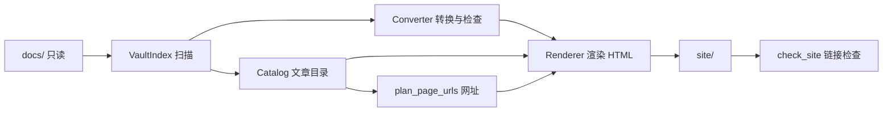

# 架构：5.0.0 读者网站

> 写于 2026-10-26，状态：**定稿，待实施**。需求见 [requirements.md](requirements.md)，术语见 [CONTEXT.md](../CONTEXT.md)，复用调研见 [reuse-research.md](reuse-research.md)，关键决策见 [adr/0001-drop-mkdocs.md](adr/0001-drop-mkdocs.md)。
>
> 标注沿用需求文档：【选定】是需求授权后由架构阶段选定的方案，可以推翻。凡写“计划”的文件、函数和命令目前还不存在；现状是 4.1.0。

## 1. 总体方案

构建仍是一条 Python 流水线，在 GitHub Actions 里跑，产物发布到 GitHub Pages，托管方式不变。变化在后半段：MkDocs 和 Material 主题整体去掉，换成项目自己的渲染层，只生成首页、全部文章、文章页和跳转页四种页面。【选定，理由见 ADR-0001】



## 2. 技术栈与运行

| 项 | 选择 | 说明 |
| --- | --- | --- |
| 语言 | Python ≥ 3.13（CI 固定 3.13.15，本地 `.venv` 是 3.14） | 沿用 |
| Markdown | Python-Markdown 3.10 + pymdown-extensions 11 | 沿用；扩展：`toc`、`admonition`、`attr_list`、`nl2br`、`sane_lists`、`tables`、`fenced_code`、`pymdownx.arithmatex`（generic） |
| 模板 | Jinja2 3.1 | 现在是 MkDocs 的间接依赖，改为直接写进 `requirements.txt` |
| front matter | PyYAML 6 | 同上，改为直接依赖 |
| 公式 | MathJax 3，固定版本（计划 `mathjax@3.2.2`），只在含公式的文章页加载 | 现在是不带版本号的 unpkg 链接 |
| 评论 | Giscus，`data-mapping="pathname"` | 沿用参数；只在文章页出现 |
| 部署 | `.github/workflows/deploy.yml`：测试 → 构建 → 上传 `site/` → Pages | 工作流不用改，变的只是 `requirements.txt` |

去掉的依赖：`mkdocs`、`mkdocs-material`。不引入 Node、打包工具或 CSS 框架；样式一个 CSS 文件，脚本一个原生 JS 文件。

## 3. 复用决策

- **复用自己的转换层**：`tools/obsidian_compat` 的扫描、转换、行号诊断、网址分配、HTML 检查全部保留，这是需求第 6 节“构建失败要说清楚”和 R-PUB-3 的基础。上游版本即本仓库 4.1.0。
- **复用库**：Python-Markdown（含 `toc` 的标题锚点规则，`slug.py` 已与之对齐，订阅教程里的中文锚点不会变）、pymdown-extensions、Jinja2、PyYAML。
- **不复用框架**：Quartz、Zensical、obsidian-export 都只作参考，原因见调研记录。
- **自己写的部分**：内容目录 `Catalog`、渲染层 `Renderer`、四个模板、样式和脚本。

## 4. 模块

按依赖方向从下到上。每个模块只列调用方需要知道的接口。

### 4.1 发布范围与内容目录 `tools/content.py`（计划，取代 `tools/site_nav.py`）

一个深模块，回答“哪些是文章、它们是什么、怎么排”。其他模块不再自己判断是否公开，也不再自己读 front matter。4.1.0 里“是否公开”在转换器、发布计数、附件规则和测试里各写了一遍，slug 用正则读、其他元数据用 YAML 读，两者对同一份 front matter 会给出不同结果，这一版都收进这个模块。

```python
STAGES: tuple[Stage, ...]          # 02思考/思考/thoughts、03初稿/初稿/drafts、04博客/博客/blog、05作品/作品/opus
SERIES: dict[str, str]             # 系列子文件夹 → 入口篇，见 §6
HOME_PAGE = Path("index.md")

def is_published(path: Path) -> bool      # 唯一的“是否公开”判断：在 STAGES 文件夹内的 .md，或首页
def read_meta(text: str) -> dict          # 唯一的 front matter 解析（YAML）；坏 front matter 返回 {}

@dataclass(frozen=True)
class Article:
    source_path: Path
    stage: Stage
    title: str              # front matter 的 title，没写就用文件名
    date: date | None       # createdDate
    tags: tuple[str, ...]
    description: str
    series: str | None      # 所属系列名（入口篇标题）；入口篇自己也属于系列

class Catalog:
    @classmethod
    def load(cls, docs: Path, pages: Iterable[Path]) -> tuple["Catalog", list[Diagnostic]]
    articles: tuple[Article, ...]           # 全部文章，createdDate 从新到旧，无日期的排最后（W_POST_DATE_MISSING）
    def home(self) -> tuple[Article, ...]   # 04博客根目录 + 05作品，同样排序（R-UI-3、R-UI-6）
    def neighbours(self, a: Article) -> tuple[Article | None, Article | None]   # 上一篇、下一篇
    def series(self, a: Article) -> tuple[Article, ...]                        # a 所在系列的阅读顺序，不在系列里时为空
```

规则：

- **阶段**只由一级文件夹决定（R-STR-1）。`stage` 是 `Article` 的必填字段，模板直接用 `stage.name` 显示。
- **上一篇 / 下一篇**：系列里的文章按系列阅读顺序；其他文章在同一阶段内按 `createdDate`，“上一篇”是更早的一篇。【选定】
- **系列**：见 §6。

### 4.2 Obsidian 转换层 `tools/obsidian_compat/`（已有，小改）

| 文件 | 接口 | 5.0.0 的变化 |
| --- | --- | --- |
| `index.py` | `VaultIndex.scan(docs)` → 页面、附件、标题锚点、块 ID | 不变 |
| `converter.py` | `Converter(index, is_published).convert(path, text)` → `ConversionResult(text, references, diagnostics)` | 构造参数从 `unpublished_paths` 改为 `content.is_published`；页面链接仍输出为指向目标 `.md` 的相对路径加锚点，由渲染层改写成网址 |
| `urls.py` | `plan_page_urls(docs, pages, is_published, prefixes)`；`write_redirects(site, redirects, site_url)` | 删除 `PageUrlPlugin`、`renamed_folder_redirects` 和逐页中文路径跳转（不再保留旧网址）；`front_matter_slug` 改用 `content.read_meta` 取值，只额外定位行号 |
| `html_check.py` | `check_site(site, site_url)` | 不变，继续检查站内链接、锚点和残留的 Obsidian 标记 |
| `parser.py`、`slug.py`、`models.py`、`diagnostics.py` | — | 不变 |

### 4.3 渲染层 `tools/render.py`（计划）

一个深模块：输入转换好的 Markdown 和目录，输出整个 `site/`。调用方只需要一个函数：

```python
def write_site(
    site: Path,
    catalog: Catalog,
    converted: Mapping[Path, str],   # 公开页面的源路径 → 转换后的 Markdown（含首页）
    urls: Mapping[Path, str],        # 源路径 → 站内网址，如 "blog/subscribe-claude-quick/"
    attachments: Iterable[Path],     # 要复制的附件（只含公开文章引用的）
    config: SiteConfig,
) -> list[Diagnostic]
```

内部负责：

- Markdown → HTML。一个 Treeprocessor 把指向 `.md` 的相对链接改写成相对网址（保留 `#锚点`），图片和附件链接改写到 `assets/` 下。目标不在 `urls` 里时返回诊断 `E_LINK_UNPUBLISHED`（正常情况下转换层已把它变成纯文字，这是兜底）。
- 每篇文章用 `toc` 扩展产出的标题列表决定是否显示目录：二级和三级标题合计 ≥ 3 个时显示。【选定】
- 套模板写出 `index.html`、`posts/index.html`、每篇文章的 `<网址>/index.html`、`404.html`，复制 `theme/assets/` 和附件。
- 所有站内链接都写相对路径，站点在 `/Writing/` 子路径下和本地 `http.server` 下都能用。

`SiteConfig` 从根目录 `site.toml`（计划，取代 `mkdocs.yml`）读取：站名、`site_url`、社交链接、Giscus 参数、`head` 里的站点验证 meta。用标准库 `tomllib`，不加依赖。

### 4.4 构建编排 `tools/build_site.py`（已有，重写后半段）

保留：清理 `.cache/` 与 `site/`、构建前后对 `docs/` 做哈希比对（`E_SOURCE_MUTATED`）、诊断统一输出、退出码（0 成功 / 1 内容问题 / 2 工具问题）、成功时打印 `build succeeded: N pages published, M unpublished`。

顺序：`VaultIndex.scan` → `Catalog.load` → 逐页 `Converter.convert`（全部页面都转换以检查双链，只保留公开页面的结果）→ `plan_page_urls` → 有诊断就停止 → `write_site` → 写跳转页 → `check_site`。

配置常量留在这个文件里：`SECTION_PREFIXES`（由 `content.STAGES` 生成，供 `plan_page_urls` 使用）和 `REDIRECTS`（§5）。`UNPUBLISHED_PATHS`、`NAV_POSTS`、`NAV_NOTES`、`ARTICLES_INDEX`、`HOME_RECENT_POSTS`、`RENAMED_SECTIONS` 删除。

## 5. 网址与跳转

| 页面 | 网址 |
| --- | --- |
| 首页 | `/` |
| 全部文章 | `/posts/`；筛选状态写在查询参数里，如 `/posts/?stage=思考&tag=二次元`，可以分享 |
| 文章 | `/<阶段前缀>/<slug 或 8 位短 ID>/`，前缀：思考 `thoughts`、初稿 `drafts`、博客 `blog`、作品 `opus` |

- slug 规则和短 ID 算法沿用 4.1.0（R-PUB-5）。短 ID 由源文件路径算出，所以迁移后的文章网址会变，这是需求允许的。
- 系列子文件夹不进网址：`04博客/操作版/x.md` 是 `/blog/<slug>/`，slug 在整个阶段内唯一。
- **跳转页**只有一处配置：

  ```python
  REDIRECTS = {"tech/subscribe-claude-quick/": Path("04博客/如何订阅claude（纯操作版）.md")}
  ```

  构建时查出目标的新网址并写跳转页（沿用 `redirect_html`：`meta refresh` + `location.replace`，保留查询串和锚点）。目标不存在或未公开时报 `E_REDIRECT_TARGET_MISSING` 并停止；跳转地址与已有页面冲突时报 `E_REDIRECT_CONFLICT`（R-PUB-4）。这篇文章已有 `slug: subscribe-claude-quick`，新地址是 `/blog/subscribe-claude-quick/`。

## 6. 系列博客

`04博客` 的子文件夹各是一个系列（R-STR-1、R-UI-6）。入口篇无法从链接可靠推断（例如《方案一断连后》链到原理版的篇数比入口篇还多），所以显式配置：【选定】

```python
SERIES = {
    "04博客/原理版": "04博客/如何订阅claude.md",
    "04博客/操作版": "04博客/如何订阅claude（纯操作版）.md",
}
```

- 系列名是入口篇的标题。入口篇在 `04博客` 根目录，出现在首页；子文件夹里的各篇只出现在全部文章页，并标出系列名。
- 阅读顺序：入口篇在前，然后是子文件夹里的文章，沿用 4.1.0 导航的排序规则（组内链接最多的页面在前，其余按它链接过去的顺序，没被链到的按文件名排在最后）。
- `04博客` 下出现没配置的子文件夹，或配置的入口篇不存在时，报 `E_SERIES_UNCONFIGURED` / `E_SERIES_ENTRY_MISSING` 并停止。其他阶段文件夹出现子文件夹时报 `E_STAGE_SUBFOLDER`。

## 7. 前端

单栏，正文最大宽度约 40em，字号和行距以中文长文阅读为准，装饰只有分隔线和灰色辅助文字，参考刘未鹏博客（R-UI-1）。颜色用 CSS 变量，`prefers-color-scheme: dark` 时切换深色（需求待决策项的默认值）。375px 下所有页面不出现横向滚动：表格、公式和代码块各自在容器内横向滚动。

| 模板（`theme/templates/`，计划） | 内容 |
| --- | --- |
| `base.html` | 顶部栏：站名（回首页）、“首页”“全部文章”两项（R-UI-2）；页脚：社交链接 |
| `home.html` | `docs/index.md` 渲染的作者的话；`Catalog.home()` 列表，每项标题、日期、阶段、简介；末尾“全部文章”入口；不放评论和筛选（R-UI-3） |
| `posts.html` | 全部文章列表，每项标题、日期、阶段、系列名、简介；阶段按钮和标签按钮两组筛选；结果为空时的提示（R-UI-4） |
| `article.html` | 标题、日期、阶段、标签、目录（条件显示）、正文、系列导航（所属系列与系列内下一篇）、上一篇 / 下一篇、Giscus（R-UI-5、R-UI-6） |

脚本 `theme/assets/site.js`（计划）只做两件事，没有 JS 时页面照常可读：

- 全部文章页的筛选：读写 `stage`、`tag` 查询参数，两个条件同时满足才显示，空结果时显示提示。每项的阶段和标签由构建写在 `data-` 属性里。
- 代码块的复制按钮。

去掉的前端内容：Material 主题与 `overrides/`、左侧导航树、站内搜索、不蒜子访问统计（`counter.js`，属于非目标）。`docs/javascripts/` 里的三个脚本移出 Obsidian 仓库（MathJax 配置并入 `site.js`）。

## 8. 目录结构

```text
docs/                         # Obsidian 仓库，构建只读（已有；一级文件夹按 R-STR-1 迁移）
site.toml                     # 计划：站点配置，取代 mkdocs.yml
tools/
├── build_site.py             # 已有：构建编排、SECTION_PREFIXES、REDIRECTS
├── content.py                # 计划：发布范围、front matter、Catalog、SERIES；取代 site_nav.py
├── render.py                 # 计划：Markdown → HTML、模板、写 site/
└── obsidian_compat/          # 已有：扫描、转换、网址、HTML 检查
theme/
├── templates/                # 计划：base / home / posts / article / 404
└── assets/                   # 计划：site.css（取代 extra.css）、site.js
tests/                        # 已有：单元测试 + 仓库级检查，按新模块改写
开发文档/                     # 需求、架构、调研、ADR、开发日志、交付记录
.github/workflows/deploy.yml  # 已有
```

删除（计划）：`mkdocs.yml`、`overrides/`、`theme/extra.css`、`docs/javascripts/`、`tools/site_nav.py`、`scripts/setup.sh`（R-CLN-3）。

放置规则：新的构建代码放 `tools/`，Obsidian 专有的处理放 `tools/obsidian_compat/`；模板和静态资源放 `theme/`，不放进 `docs/`；测试按被测模块命名为 `tests/test_<模块>.py`；设计文档放 `开发文档/`（不能放 `docs/`，那是 Obsidian 仓库）。

## 9. 生成物与版本

- 转换副本：`.cache/converted-docs/`。渲染层直接用内存里的结果，这个目录只为排错时能看到转换后的 Markdown。
- 网站：`site/`，附件复制到 `site/assets/`，保持 `09附件` 下的相对路径。
- 两者都已在 `.gitignore` 中，不提交。
- 版本号来源不变：`开发文档/DEVELOPMENT.md` 的开发日志和 README 的“当前版本”。这一版是 5.0.0（文件夹、网址和前端都不兼容）。

## 10. 内容迁移（M1、M2）的工程做法

迁移和清理是一次性的内容操作，不做成仓库里的脚本：

- 用 `git mv` 移动文件，保留历史；双链按新路径批量改写（`newLinkFormat: absolute`，双链都以一级文件夹开头，可以按前缀替换），改完用构建的双链检查确认没有目标缺失。
- 删除 `02笔记`、`09归档` 前，先用 `VaultIndex` 算出“只被它们引用的附件”和“指向它们的双链”，列表随提交说明一起留档（R-CLN-1、R-CLN-2）。
- `tests/test_repository.py` 增加结构检查：一级文件夹集合等于 R-STR-1 的表、阶段文件夹（`04博客` 除外）没有子文件夹、`09附件` 里没有不被引用的文件、`docs/` 里没有站点脚本。
- `docs/01系统/分类标准.md`、项目 `AGENTS.md` 的“项目说明”随迁移同步改写（三级边界 Always）。`docs/.obsidian/` 里 Inbox Filer 的配置如果写死了旧文件夹名，需要先问作者（Ask first）。

## 11. 验证

| 需求 | 自动化 | 手工 |
| --- | --- | --- |
| R-STR-1、R-STR-5、R-CLN-1、R-CLN-3 | `test_repository.py` 的结构检查；构建无 `E_LINK_MISSING` | 对比迁移前后的 `.md` 文件清单 |
| R-PUB-1、R-PUB-2 | `test_content.py`：`is_published` 边界；构建后检查 `site/` 只含四个阶段的文章，且不含任何不公开页面的标题 | — |
| R-PUB-3 | `check_site` 检查站内链接和锚点；`test_render.py` 覆盖链接改写和图片 | 打开《CLANNAD》 |
| R-PUB-4 | `test_urls.py`：跳转目标解析和冲突；构建后检查 `site/tech/subscribe-claude-quick/index.html` | 浏览器访问旧地址 |
| R-PUB-5 | `test_urls.py`：增删其他文章不改变已有网址 | — |
| R-UI-1～R-UI-6 | `test_content.py`：首页列表、排序、上下篇、系列；`test_render.py`：顶部栏两项、首页无思考/初稿、目录显示条件 | 在 375px 和桌面宽度下用浏览器检查三种页面、筛选和空结果提示、复制按钮、公式、评论区 |

命令沿用：`.venv/bin/python -m unittest discover -s tests`，然后 `.venv/bin/python tools/build_site.py`；本地预览 `.venv/bin/python -m http.server -d site 8000`。

## 12. 待定与留给作者的事项

- **README 过时内容**（README 由作者维护，Ask first）：5.0.0 落地后，以下段落不再准确，需要作者决定怎么改：开头的“MkDocs + Material”和“学习笔记”；“日常写作流程”的“移到对应文件夹”；“导航与思考列表”整节；“页面网址”里的中文路径跳转、`RENAMED_SECTIONS`、“不能动的链接”；“评论区与外链”里的 `mkdocs.yml`、`repo_url`、Material 图标；“仓库结构”整节。
- **系列的阅读顺序**沿用 4.1.0 规则，如果实施时发现某个系列的顺序不对，再考虑在 `SERIES` 里改为显式列出顺序。
- **深色模式**按需求默认跟随系统，不做手动切换。
