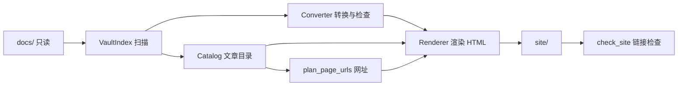

# 架构：5.0.0 读者网站

> 写于 2026-10-26，状态：5.0.0 已上线；5.1.0 视觉改版见 §7.1 和 §14，待实施。需求见 [requirements.md](requirements.md)，术语见 [CONTEXT.md](../CONTEXT.md)，复用调研见 [reuse-research.md](reuse-research.md)，关键决策见 [adr/0001-drop-mkdocs.md](adr/0001-drop-mkdocs.md)。
>
> 标注沿用需求文档：【选定】是需求授权后由架构阶段选定的方案，可以推翻。凡写“计划”的文件、函数和命令目前还不存在；现状是 4.1.0。

## 1. 总体方案

构建仍是一条 Python 流水线，在 GitHub Actions 里跑，产物发布到 GitHub Pages，托管方式不变。变化在后半段：MkDocs 和 Material 主题整体去掉，换成项目自己的渲染层，只生成首页、全部文章、文章页和跳转页四种页面。【选定，理由见 ADR-0001】



## 2. 技术栈与运行

| 项 | 选择 | 说明 |
| --- | --- | --- |
| 语言 | Python ≥ 3.13（CI 固定 3.13.15，本地 `.venv` 是 3.14） | 沿用 |
| Markdown | Python-Markdown 3.10 + pymdown-extensions 11 | 沿用；扩展：`toc`、`admonition`、`attr_list`、`nl2br`、`sane_lists`、`tables`、`fenced_code`、`pymdownx.arithmatex`（generic） |
| 模板 | Jinja2 3.1 | 现在是 MkDocs 的间接依赖，改为直接写进 `requirements.txt` |
| front matter | PyYAML 6 | 同上，改为直接依赖 |
| 公式 | MathJax 3，固定版本（计划 `mathjax@3.2.2`），只在含公式的文章页加载 | 现在是不带版本号的 unpkg 链接 |
| 评论 | Giscus，`data-mapping="pathname"` | 沿用参数；只在文章页出现 |
| 部署 | `.github/workflows/deploy.yml`：测试 → 构建 → 上传 `site/` → Pages | 工作流不用改，变的只是 `requirements.txt` |

去掉的依赖：`mkdocs`、`mkdocs-material`。不引入 Node、打包工具或 CSS 框架；样式一个 CSS 文件，脚本一个原生 JS 文件。

## 3. 复用决策

- **复用自己的转换层**：`tools/obsidian_compat` 的扫描、转换、行号诊断、网址分配、HTML 检查全部保留，这是需求第 6 节“构建失败要说清楚”和 R-PUB-3 的基础。上游版本即本仓库 4.1.0。
- **复用库**：Python-Markdown（含 `toc` 的标题锚点规则，`slug.py` 已与之对齐，订阅教程里的中文锚点不会变）、pymdown-extensions、Jinja2、PyYAML。
- **不复用框架**：Quartz、Zensical、obsidian-export 都只作参考，原因见调研记录。
- **自己写的部分**：内容目录 `Catalog`、渲染层 `Renderer`、四个模板、样式和脚本。

## 4. 模块

按依赖方向从下到上。每个模块只列调用方需要知道的接口。

### 4.1 发布范围与内容目录 `tools/content.py`（计划，取代 `tools/site_nav.py`）

一个深模块，回答“哪些是文章、它们是什么、怎么排”。其他模块不再自己判断是否公开，也不再自己读 front matter。4.1.0 里“是否公开”在转换器、发布计数、附件规则和测试里各写了一遍，slug 用正则读、其他元数据用 YAML 读，两者对同一份 front matter 会给出不同结果，这一版都收进这个模块。

```python
@dataclass(frozen=True)
class Stage:
    folder: str             # 文件夹路径前缀，如 "02思考"；按最长前缀匹配，所以也可以是 "03思考/初稿"
    name: str               # 思考 / 初稿 / 博客 / 作品
    prefix: str             # 网址前缀 thoughts / drafts / blog / opus

@dataclass(frozen=True)
class Layout:               # 文件夹与阶段的对应，加上系列配置
    stages: tuple[Stage, ...]
    series: dict[str, str]  # 系列子文件夹 → 入口篇，见 §6

LAYOUT: Layout              # 5.0.0 的正式对应：02思考、03初稿、04博客、05作品
HOME_PAGE = Path("index.md")

def is_published(path: Path, layout: Layout = LAYOUT) -> bool   # 唯一的“是否公开”判断：属于某个阶段的 .md，或首页
def read_meta(text: str) -> dict          # 唯一的 front matter 解析（YAML）；坏 front matter 返回 {}

@dataclass(frozen=True)
class Article:
    source_path: Path
    stage: Stage
    title: str              # front matter 的 title，没写就用文件名
    date: date | None       # createdDate
    tags: tuple[str, ...]
    description: str
    series: str | None      # 所属系列名（入口篇标题）；入口篇自己也属于系列
    url: str = ""           # 站内网址，由渲染层按 urls 填好再交给模板（T2 加）

class Catalog:
    @classmethod
    def load(cls, docs: Path, pages: Iterable[Path], layout: Layout = LAYOUT) -> tuple["Catalog", list[Diagnostic]]
    articles: tuple[Article, ...]           # 全部文章，createdDate 从新到旧，无日期的排最后（W_POST_DATE_MISSING）
    def home(self) -> tuple[Article, ...]   # 不在系列子文件夹里的博客 + 全部作品，同样排序（R-UI-3、R-UI-6）
    def neighbours(self, a: Article) -> tuple[Article | None, Article | None]   # 上一篇、下一篇
    def series(self, a: Article) -> tuple[Article, ...]                        # a 所在系列的阅读顺序，不在系列里时为空
    def entry_of(self, folder: str) -> Article | None                          # 系列的入口篇
    def article(self, source_path: Path) -> Article | None

def series_diagnostics(docs: Path, pages: Iterable[Path], layout: Layout = LAYOUT) -> list[Diagnostic]
    # E_STAGE_SUBFOLDER / E_SERIES_ENTRY_MISSING / E_SERIES_UNCONFIGURED，见 §6
```

规则：

- **阶段**只由一级文件夹决定（R-STR-1）。`stage` 是 `Article` 的必填字段，模板直接用 `stage.name` 显示。
- **上一篇 / 下一篇**：系列里的文章按系列阅读顺序；其他文章在同一阶段内按 `createdDate`，“上一篇”是更早的一篇。【选定】
- **系列**：见 §6。
- **坏 front matter**：`_read_article` 里再解析一次 YAML（`_strict_meta`），解析不了报 `E_FRONT_MATTER_INVALID` 并停止；`read_meta` 本身仍对坏数据返回 `{}`，供只需要容错的调用方（转换层取 slug）使用。
- **阶段按最长前缀匹配，诊断里也一样**：`E_STAGE_SUBFOLDER` 只对“最具体的那个阶段”的页面报警，否则预览用旧布局时 `03思考/初稿` 下的两篇初稿会被算成“思考的子文件夹”。`E_SERIES_ENTRY_MISSING` 只要求入口篇在它**所属阶段的根目录**（正式布局 `04博客/`，预览的旧布局 `04技术/`），不要求它在系列文件夹里。`E_SERIES_UNCONFIGURED` 对每个真实的顶层子文件夹只报一次。
- **`W_` 开头的诊断只提示**：`build_pages` 遇到警告照常写完站点，只有错误才提前返回。`W_POST_DATE_MISSING` 让缺日期的文章排在最后（R-UI-4）；`W_MATHJAX_UNUSED` 是一篇带公式的公开文章都没有时的自检提示。
- **系列文件夹里可能还有一份作者手写的目录页**（如 `04技术/原理版/如何订阅claude.md`），它也是系列成员，但系列顺序从 `Layout.series` 登记的入口篇开始。`series()` 按源路径去重，`_reading_order` 以入口篇为起点沿双链展开，没被链到的按文件名排最后。
- **`home()` 的口径**：属于某个阶段、且不在任何系列文件夹里的文章；`series()` 返回空元组表示不在系列里，模板用 `series[0].url` 指到入口篇。
- **标签按钮顺序**：`_tag_counts` 按篇数从多到少、同数按字典序，避免每次构建按钮顺序抖动。
- **配置**：`site.toml` 的 `[giscus]` 里 `repo`、`repo_id`、`category_id` 三项齐全时 `GiscusConfig.enabled` 为真，文章页才输出评论区脚本；`[[social]]` 每项 `name` + `url`，渲染在页脚。

### 4.2 Obsidian 转换层 `tools/obsidian_compat/`（已有，小改）

| 文件 | 接口 | 5.0.0 的变化 |
| --- | --- | --- |
| `index.py` | `VaultIndex.scan(docs)` → 页面、附件、标题锚点、块 ID | 不变 |
| `converter.py` | `Converter(index, is_published).convert(path, text)` → `ConversionResult(text, references, diagnostics)` | 构造参数从 `unpublished_paths` 改为 `content.is_published`；页面链接仍输出为指向目标 `.md` 的相对路径加锚点，由渲染层改写成网址 |
| `urls.py` | `plan_page_urls(docs, pages, is_published, prefixes)`；`write_redirects(site, redirects, site_url)`；`legacy_redirects(site, pairs, site_url)`（T2 加） | 删除 `PageUrlPlugin`、`renamed_folder_redirects` 和逐页中文路径跳转（不再保留旧网址）；`front_matter_slug` 改用 `content.read_meta` 取值，只额外定位行号 |
| `html_check.py` | `check_site(site, site_url)`；`check_body(site, page_url, body)` | 新增 `check_body`：只检查单页正文的链接、锚点和残留标记。T1 只生成文章页，模板里的站名和样式表指向尚未生成的页面，整站检查会在 T2 补齐页面后才用 |
| `parser.py`、`slug.py`、`models.py`、`diagnostics.py` | — | 不变 |

### 4.3 渲染层 `tools/render.py`

一个深模块：输入转换好的 Markdown 和目录，输出整个 `site/`。入口是 `write_site`，
扫描和转换在 `build_pages` 里完成后再交给它：

```python
def write_site(
    site: Path,
    catalog: Catalog,
    converted: Mapping[str, str],   # 公开页面的源路径（POSIX 字符串）→ 转换后的 Markdown
    urls: Mapping[str, str],        # 源路径（POSIX 字符串）→ 站内网址，如 "blog/subscribe-claude-quick/"
    attachments: Iterable[Path],    # 要复制的附件（只含公开文章引用的）
    config: SiteConfig,
    docs: Path,                     # 复制附件时读源文件
    index: VaultIndex,              # 查目标页面的标题锚点
    references: Mapping[str, list], # 源路径 → ConversionResult.references
    diagnostics: list[Diagnostic] | None = None,
    legacy: Iterable[tuple[str, str]] = (),   # 旧地址 → 现地址，交给 urls.legacy_redirects（T2 加）
) -> list[Diagnostic]

def build_pages(
    docs: Path,
    destination: Path,
    config: SiteConfig,
    layout: Layout = LAYOUT,
    legacy: Iterable[tuple[str, str]] = (),
) -> list[Diagnostic]
```

`write_site` 用 `urls.legacy_redirects(site, [(旧, 新)], site_url)` 写跳转页：地址先规整成 `/a/b/`，目标页面不存在报 `E_REDIRECT_TARGET_MISSING`，与已有页面冲突由 `write_redirects` 报 `E_REDIRECT_CONFLICT`。`Page` 带 `url`、`articles`、`previous`、`following`、`series`、`toc`、`tags`、`rows`、`comments`、`highlight_nav` 这些模板字段；`_context` 另给 `root`（到站点根目录的相对路径）、`mathjax`、`unit_separator`（列表项 `data-tags` 的分隔符，用不可见的 U+0001，因为主题标签里可能出现逗号）。所有页面都加载 `site.js`；MathJax 只在 `page.has_math` 的页面加载，判定依据是转换后 Markdown 里的 `$$…$$` / `$…$`。

`build_pages` 负责 `VaultIndex.scan` → `Converter.convert`（全部公开页面）→ `plan_page_urls`
→ `Catalog.load`，收集要复制的附件后调用 `write_site`。预览入口和单元测试都走 `build_pages`。

内部负责：

- Markdown → HTML。先剥掉 front matter（4.1.0 由 MkDocs 的 `meta` 扩展做），再交给 Python-Markdown。指向 `.md` 的链接按 `ConversionResult.references` 里已解析的目标改写成相对网址并保留锚点；目标不在 `urls` 里（不公开或不存在）时只留文字。标题锚点用转换层同一套 slug 规则，标题没有 ASCII 字符时是 `_1`、`_2`。
- 嵌入的附件复制到 `assets/<原目录>/<原名>`，地址按当前页面深度写成相对路径，文件名含空格和中文时按百分号编码。
- 每篇文章用 `toc` 扩展产出的标题列表决定是否显示目录：二级和三级标题合计 ≥ 3 个时显示。【选定】
- 套模板写出 `index.html`、`posts/index.html`、每篇文章的 `<网址>/index.html`、`404.html`，复制 `theme/assets/` 和附件。
- 所有站内链接都写相对路径，站点在 `/Writing/` 子路径下和本地 `http.server` 下都能用。

`SiteConfig` 从根目录 `site.toml`（取代 `mkdocs.yml`）读取：站名、`site_url`、`theme` 目录。T1 只需这三项，社交链接、Giscus 参数和站点验证 meta 在 T2 加。T1 用 Jinja2 渲染模板，`requirements.txt` 已固定 `Jinja2==3.1.6`、`PyYAML==6.0.3`。

### 4.4 构建编排 `tools/build_site.py`（已有，重写后半段）

保留：清理 `.cache/` 与 `site/`、构建前后对 `docs/` 做哈希比对（`E_SOURCE_MUTATED`）、诊断统一输出、退出码（0 成功 / 1 内容问题 / 2 工具问题）、成功时打印 `build succeeded: N pages published, M unpublished`。

顺序：`VaultIndex.scan` → `Catalog.load` → 逐页 `Converter.convert`（全部页面都转换以检查双链，只保留公开页面的结果）→ `plan_page_urls` → 有诊断就停止 → `write_site` → 写跳转页 → `check_site`。

配置常量留在这个文件里：`REDIRECTS`（§5）；网址前缀由 `content.LAYOUT` 的各阶段给出，`plan_page_urls` 改为按阶段取前缀，不再用 `SECTION_SLUGS`。`UNPUBLISHED_PATHS`、`NAV_POSTS`、`NAV_NOTES`、`ARTICLES_INDEX`、`HOME_RECENT_POSTS`、`RENAMED_SECTIONS` 删除。

## 5. 网址与跳转

| 页面 | 网址 |
| --- | --- |
| 首页 | `/` |
| 全部文章 | `/posts/`；筛选状态写在查询参数里，如 `/posts/?stage=思考&tag=二次元`，可以分享 |
| 文章 | `/<阶段前缀>/<slug 或 8 位短 ID>/`，前缀：思考 `thoughts`、初稿 `drafts`、博客 `blog`、作品 `opus` |

- slug 规则和短 ID 算法沿用 4.1.0（R-PUB-5）。短 ID 由源文件路径算出，所以迁移后的文章网址会变，这是需求允许的。
- 系列子文件夹不进网址：`04博客/操作版/x.md` 是 `/blog/<slug>/`，slug 在整个阶段内唯一。
- **跳转页**只有一处配置：

  ```python
  REDIRECTS = {"tech/subscribe-claude-quick/": Path("04博客/如何订阅claude（纯操作版）.md")}
  ```

  构建时查出目标的新网址并写跳转页（沿用 `redirect_html`：`meta refresh` + `location.replace`，保留查询串和锚点）。目标不存在或未公开时报 `E_REDIRECT_TARGET_MISSING` 并停止；跳转地址与已有页面冲突时报 `E_REDIRECT_CONFLICT`（R-PUB-4）。这篇文章已有 `slug: subscribe-claude-quick`，新地址是 `/blog/subscribe-claude-quick/`。
  T2 的实现：`REDIRECTS` 声明在 `tools/build_site.py`（`{"tech/subscribe-claude-quick": "blog/subscribe-claude-quick"}`，不带首尾斜杠），4.1.0 的构建不读它，线上网址一字不变；`tools/preview_v5.py` 把它转成 `(旧, 新)` 列表传给 `build_pages`。T3 换流水线时 `build_site.py` 直接把这个字典交给 `write_site` 的 `legacy` 参数。

## 6. 系列博客

`04博客` 的子文件夹各是一个系列（R-STR-1、R-UI-6）。入口篇无法从链接可靠推断（例如《方案一断连后》链到原理版的篇数比入口篇还多），所以显式配置：【选定】

```python
SERIES = {
    "04博客/原理版": "04博客/如何订阅claude.md",
    "04博客/操作版": "04博客/如何订阅claude（纯操作版）.md",
}
```

- 系列名是入口篇的标题。入口篇在 `04博客` 根目录，出现在首页；子文件夹里的各篇只出现在全部文章页，并标出系列名。
- 阅读顺序：入口篇在前，然后是子文件夹里的文章，沿用 4.1.0 导航的排序规则（组内链接最多的页面在前，其余按它链接过去的顺序，没被链到的按文件名排在最后）。
- `04博客` 下出现没配置的子文件夹，或配置的入口篇不存在时，报 `E_SERIES_UNCONFIGURED` / `E_SERIES_ENTRY_MISSING` 并停止。其他阶段文件夹出现子文件夹时报 `E_STAGE_SUBFOLDER`。

## 7. 前端

单栏，正文最大宽度约 40em，字号和行距以中文长文阅读为准，装饰只有分隔线和灰色辅助文字，参考刘未鹏博客（R-UI-1）。颜色用 CSS 变量，`prefers-color-scheme: dark` 时切换深色（需求待决策项的默认值）。375px 下所有页面不出现横向滚动：表格、公式和代码块各自在容器内横向滚动。

| 模板（`theme/templates/`，计划） | 内容 |
| --- | --- |
| `base.html` | 顶部栏：站名（回首页）、“首页”“全部文章”两项（R-UI-2）；页脚：社交链接 |
| `home.html` | 封面式首页（5.1.0 V3）：气泡里的标题（`docs/index.md` 第一段）和作者的话、右侧竖排的“想法”“灵感”淡色大字、黑圈总数；两条线卡片，“冒出一个想法 → 思考 → 博客”“来了一点灵感 → 初稿 → 作品”，阶段名链到 `posts/?stage=…`，卡片上写各阶段篇数；`Catalog.home()` 的列表按月分组，组头是大号月份数字，每项标题、日期、阶段、简介；末尾“全部文章”入口；不放评论和筛选（R-UI-3） |
| `posts.html` | 全部文章列表，每项标题、日期、阶段、系列名、简介；阶段按钮和标签按钮两组筛选；结果为空时的提示（R-UI-4） |
| `article.html` | 标题、日期、阶段、标签、目录（条件显示）、正文、系列导航（所属系列与系列内下一篇）、上一篇 / 下一篇、Giscus（R-UI-5、R-UI-6） |
| `404.html` | “页面不存在”加回首页、全部文章的入口（R-PUB-4） |

脚本 `theme/assets/site.js`（计划）只做两件事，没有 JS 时页面照常可读：

- 全部文章页的筛选：读写 `stage`、`tag` 查询参数，两个条件同时满足才显示，空结果时显示提示。每项的阶段和标签由构建写在 `data-` 属性里。
- 代码块的复制按钮（`navigator.clipboard` 为主，`execCommand` 兜底）。

涂鸦的五个 symbol 用 `currentColor` 和 `var(--doodle-line)` 取色，颜色由外层 `.doodle`（默认 `--ink`，首页压在大字上的两份加 `.accent`）决定：`<use>` 引用的 symbol 在 shadow 树里，外面写选择器改不到它的描边。小号文字不用纯强调色和芥黄（白底上分别只有 4.02:1 和 1.93:1），改用 `--accent-text`、`--mustard-text`；色块和描边仍用原色。

实现要点（T2）：筛选按钮和筛选结果摘要默认 `hidden`，由 `site.js` 显示，所以没有 JS 时按钮不出现、列表全部可见；查询参数里的阶段或标签对不上任何按钮时按“没筛选”处理；筛选状态用 `history.replaceState` 写回地址，可以分享。样式集中在 `theme/assets/site.css` 一个文件里，颜色走 CSS 变量，`prefers-color-scheme: dark` 时整体切换；MathJax 的读屏辅助层 `mjx-assistive-mml` 挪出排版流（否则会撑出横向滚动），行内公式和行间公式各自在容器内横向滚动。

去掉的前端内容：Material 主题与 `overrides/`、左侧导航树、站内搜索、不蒜子访问统计（`counter.js`，属于非目标）。`docs/javascripts/` 里的三个脚本移出 Obsidian 仓库（MathJax 配置并入 `site.js`）。

### 7.1 5.1.0 视觉改版

需求见 [requirements.md §9](requirements.md)，样稿是 [设计样稿/5.1.0-首页与文章页.html](设计样稿/5.1.0-首页与文章页.html)。信息结构和模板的数据来源都不变，改的是样式、模板标记和几处由渲染层算出来的展示数据。上面“装饰只有分隔线和灰色辅助文字”一句作废。

**样式**：`theme/assets/site.css` 整份重写，颜色和字体都是 `:root` 上的变量（名字照样稿：`--paper`、`--ink`、`--ink-soft`、`--rule`、`--accent`、`--pink`、`--peach`、`--sky`、`--mustard`、四个阶段的 `--chip-*`、`--shadow`，V3 又加了 `--accent-text`、`--mustard-text`、`--doodle-line`），深色只重新定义变量（5.2.0 起写两份：`prefers-color-scheme: dark` 下的 `:root:not([data-theme="light"])`，和读者手动选黑夜时的 `:root[data-theme="dark"]`）。不再引入框架；涂鸦用 `base.html` 里的一份内联 SVG `<symbol>`（`star`、`note`、`note1`、`drop`、`think`），各模板用 `<use href="#star">` 引用。

**数据（计划）**：

```python
# tools/content.py
class Article:
    updated: date | None                    # 新增：updatedDate，标题区显示“改于”
class Catalog:
    def stage_counts(self) -> dict[str, int]  # 新增：阶段名 → 篇数，首页两张卡片用；键按 LAYOUT 的阶段顺序，
                                             # 口径是 catalog.articles（含系列子篇），没有的阶段为 0

# tools/render.py
def giant_chars(title: str) -> tuple[str, str]
    # 先去掉标题末尾的括号注释（如“黑框眼镜（作品）”的“（作品）”）和开头的序号（“三、”“12.”）。
    # 主大字：标题里第一个汉字或字母（字母转大写），跳过标点和空白；标题去掉标点后不少于 4 个字时，
    # 第二个是最后两个非标点字符（汉字标题就是最后两个汉字，英文标题就是最后两个字母，
    # 如 "CLANNAD~AFTER STORY~" → ("C", "RY")），否则为 ""。全是标点时返回 ("", "")，模板不画大字。
def strip_leading_title(markdown: str, titles: Iterable[str]) -> str
    # 5.1.1：正文第一行非空内容是和标题相同的一级标题时删掉它，只比较完全相同的文字
def strip_date_notes(markdown: str) -> str
    # 只看正文开头的引用块区域：删掉形如 `> 写于 2026-08-29`、`>更新于 2026-10-20` 的整行；
    # 同一引用块里的其他行（星级、“下一季”链接、说明文字）保留；遇到第一行既不是引用也不是空行就停。
    # 按块处理：含日期行的块逐行只删日期行，所以两个空行隔开的日期块、以及日期行后面紧跟
    # 说明文字的块都能正确保留说明；空行后面还有引用行时仍算同一块（渲染后是同一个 <blockquote>）。
def reading_minutes(html: str) -> int     # 去标签后的非空白字符数 / 400，四舍五入，最少 1
def split_home_intro(html: str) -> tuple[str, str]
    # 作者的话按原样保留这段 HTML 的其余部分。开头必须是 <h1>（docs/index.md 的一级标题），
    # 去掉它之后紧跟的那个 <p> 的文字（去标签、压空白）作气泡标题；开头不是 <h1>、或者 <h1> 后面
    # 不是段落，headline 为空串，去掉 <h1> 后的整段都算作者的话
def group_by_month(articles: Iterable[Article]) -> tuple[tuple[int, int | None, tuple[Article, ...]], ...]
    # 按 createdDate 的年、月分组，组和组内都保持传入顺序（新到旧）；没有日期的合成最后一组，
    # 年、月都是 None。首页和 V4 的全部文章页共用它
```

`Page` 增加 `giant`、`giant_second`、`minutes`、`headline`、`stage_counts`、`total`、`months` 七个字段，由 `write_site` 填；`strip_date_notes` 在 `render_markdown` 之前对文章正文调用，不影响源文件，也不影响转换层的双链检查（检查早已在转换时做完）。首页卡片链接写成 `posts/?stage=思考`，复用 `site.js` 已有的查询参数筛选，不加新脚本。首页的 `total` 是 `len(catalog.articles)`，即公开文章总数，不是首页列表的条数；`months` 只装 `catalog.home()` 的结果（博客和作品，R-UI-3）；`stage_counts` 和全部文章页同口径。气泡下的 “finderlzy's writing” 写死在 `home.html` 里，不读 `site.toml`：它是封面上的装饰字，换站名不该跟着变。

**字体（V0 已实测，2026-10-26）**：新模块 `tools/fonts.py`。结论是原设想成立，四个 woff2 合计 81.4 KB（预算 300 KB），五个文件子集化 0.62 秒，排版度量与在线字体一致；下面把 V0 改掉的三处单独标出。

```python
@dataclass(frozen=True)
class FontSpec:
    role: str          # "head" | "cute" | "slab" | "hand"，对应模板里的 data-font 属性
    source: Path       # 源字体文件（可指向 theme/fonts/ 或 CI 下载到的临时目录）
    output: str        # 写到 site/assets/fonts/<output>.woff2
    text: str | None = None       # 固定要带的字；模板里没写 data-font 的数字、标点靠它
    weight: int = 400             # 可变字体固定到的 wght，静态字体保持默认
    optional: tuple[str, ...] = ()  # 只在源字体里出现过的字：有就收，没有不报错，交给下一个字体兜底
    family: str = ""              # 覆盖 @font-face 的家族名；默认用源字体自己的名字

def collect_chars(site: Path) -> dict[str, set[str]]   # 扫描生成的 HTML，按 data-font 收集各角色用到的字
def subset_one(spec: FontSpec) -> Path                  # 子集化 + 写 woff2，返回写出的文件
def subset_fonts(site: Path, specs: Iterable[FontSpec]) -> list[Diagnostic]
    # 源文件缺失报 E_FONT_SOURCE_MISSING；源字体里没有某个必需字报 W_FONT_GLYPH_MISSING（只提示，
    # 浏览器会用字体栈里的下一个字体补齐）；全部字体合计超过 300 KB 报 W_FONT_BUDGET（只提示）
```

| 角色 | 字体（OFL） | 用在哪里 | 实测 woff2 |
| --- | --- | --- | --- |
| head | Noto Sans SC 可变字体固定到 wght=900 | 标题、淡色大字、气泡标题、月份以外的粗字 | 50,336 B |
| cute | ZCOOL KuaiLe | “讲了什么”、“完”、卡片上的短句、区块标题 | 2,512 B |
| slab 600 | Zilla Slab SemiBold | 数字和日期（月份数字、列表日期、“10.21”）、“pieces”“min read”等短标签 | 14,684 B |
| slab 700 | Zilla Slab Bold | 站名、气泡标题下的“finderlzy's writing”、阶段英文前缀、月份名、卡片标题 | 14,528 B |
| hand | Gochi Hand | 首页列表标题旁手写的 “yep!” | 1,276 B |

合计 83,336 B（81.4 KB），预算 300 KB，余量 223.8 KB。子集化单独计时：五个文件合计 0.62 秒（三次重跑 0.97、0.97、1.00 秒，含 Python 启动和读源文件）；`build_site.py` 做一次完整构建，这一步多花不到 1 秒，远低于 10 秒线。

**四条成功标准都达到**：四个 woff2 合计 81.4 KB ≤ 300 KB；子集化 0.62 秒 ≤ 10 秒；head 的 388 个字、cute 的 22 个字、hand 的 4 个字在源字体里全部有；截图里的字形和在线字体一致（下面“截图对比”）。head 只收标题首字、标题正文退回系统粗体的退路用不上，不必请作者选。

**收字**（`collect_chars`，V0 用的是按同样规则在仓库外跑出来的一组字，V1 要在构建里重算）：

- head：全部公开文章的标题（用 `Catalog.load` 读，108 篇，不是自己解析 front matter）、`docs/index.md` 正文第一个非标题段落、`首页 全部文章 博客与作品 想法 灵感 思考 初稿 博客 作品 404`、数字 0～9。合计 388 个不同字符，Noto Sans SC 全部覆盖。V0 实测：每个汉字约 120～140 B，20 个字就是 2.5 KB，所以这个字数增长是线性的；标题总量翻一倍也只到 130 KB 左右，离 300 KB 还很远。
- cute：`讲了什么 完 冒出一个想法 来了一点灵感 博客与作品 留言`，22 字，全部覆盖。不需要整个字符库（全字符库要 39 KB，是现在的 15 倍）。
- slab：可打印 ASCII 32～126 共 95 个，加上排版会出现的 `· — “ ” ×`。注意 Zilla Slab 里没有汉字，模板里凡是中文（“分”“篇”“留言”“写”“改”“月”等）必须交给别的角色，否则会静默回退到系统字体。
- hand：`yep!` 4 字。

**依赖和构建顺序**：`requirements.txt` 新增 `fonttools==4.67.0`、`brotli==1.2.1`（本机 Python 3.14.4、全新的虚拟环境实测；fontTools 4.67.0 要求 `brotli>=1.1`）。`build_pages` 在 `write_site` 之后、`check_site` 之前调用 `subset_fonts`。`@font-face` 写在 `site.css` 里，`font-display: swap`，正文不加载网络字体，用系统字体栈（PingFang SC、Microsoft YaHei、Noto Sans CJK SC）。字体加载失败时退回系统字体，页面照样能读，只是没有封面感。

**V0 改掉的三处设想**：

1. **head 不要先生成 wght=900 的静态 TTF 再子集化。** “用 instancer 固定到 wght=900”有两种顺序，代价差很多：先实例化会把 31,036 个字形整份重算一遍，再写成 woff2 要 23.9 秒、3.9 MB；改成**先子集化可变字体、再 `instancer.instantiateVariableFont(font, {"wght": 900})`** 之后，实例化只要 0.04 秒、woff2 0.04 秒左右。两种顺序产出的字重和度量相同（子集化的字形完全一样；无 hinting 时实例化就是坐标插值，50,420 B 对 50,364 B 的差别来自时间戳和名字表）。所以 V1 直接按“先子集化、后实例化”写，不要生成中间 TTF。
2. **slab 要两个脸、多个 output。** `FontSpec` 原来是一个角色一个文件，而 Zilla Slab 的两个字重要分别子集化成 `slab-600.woff2`、`slab-700.woff2`，模板里按 `data-font="slab"` → `--font-slab` → `font-weight: 600/700` 各取一张。`FontSpec` 增加 `weight` 和 `family`：family 统一写成 `"Zilla Slab Lzy"`（把名字里的 "SemiBold" 去掉、把 `OS/2.usWeightClass` 设成 600/700，CSS 才会把两张当同一个家族的两个字重）。注意 0.1 KB 的差别：改不改名字对体积没有意义（25,548 B 对 25,400 B），改名是为了 CSS 匹配正确。同样，`head` 的家族名从 `@font-face` 直接写成 `"Noto Sans SC"`，不要接受字体内部自带的 “Noto Sans SC Thin Black”。
3. **子集化选项决定了体积，必须写死。** `subset.Options` 要设 `name_IDs = [1, 2, 4, 6]`、`name_languages = [0x409]`（默认会留 copyright、license、license 链接、版本等条目，head 因此多出约 3.1 KB）、`notdef_outline = True`、`drop_tables += ["FFTM"]`（不设会打一行 `FFTM NOT subset` 警告）。**不要**把 `layout_features` 写成 `["*"]`：默认值只留 `kern`，全开会把 Noto Sans SC 的 `palt`、`halt`、`vert`、`vrt2` 之类的排版特性带进来，head 从 50 KB 涨到 65 KB，而中文标题用不上这些特性。

**许可**：四款都是 SIL OFL 1.1。OFL 要求分发字体时带上许可，所以 `theme/fonts/OFL.txt` 里放四份原文（`Noto Sans SC`、`ZCOOL KuaiLe`、`Zilla Slab`、`Gochi Hand`，每份前面写清对应的源文件），`theme/fonts/README.md` 记下载地址、提交号和 SHA-256。改名字（第 2 条）这一步碰到 OFL 第 3 条：改过的字体不能继续用 Reserved Font Name 宣传。Noto Sans SC 的 OFL 里保留的名字是 'Source'，Gochi Hand 保留的是 "Gochi" 和 "Gochi Hand"，Zilla Slab、ZCOOL KuaiLe 没有保留名。用 `"Zilla Slab Lzy"` 不冲突；Gochi Hand 只子集化、不改名，保留原名没有问题；head 的 @font-face 直接用 `"Noto Sans SC"`，只是 CSS 里的引用，不改字体内部名字。四款都只放子集化产物、不单独分发，许可原文随 `theme/fonts/OFL.txt` 一起放。

**源字体来源**（google/fonts 仓库 `main` 分支，提交 `e7db6ca603fd4862010383ff17ffd6cc4ffac1c0`，2026-10-22；“`e7db6ca`” 就是把 URL 里的 `main` 换成这个提交号，固定下来之后内容不会再变）：

| 文件 | 仓库路径 | 下载后 SHA-256 | 体积 |
| --- | --- | --- | --- |
| NotoSansSC-VF.ttf | `ofl/notosanssc/NotoSansSC[wght].ttf` | `a3041811a78c361b1de50f953c805e0244951c21c5bd412f7232ef0d899af0da` | 17,772,300 B |
| ZCOOLKuaiLe-Regular.ttf | `ofl/zcoolkuaile/ZCOOLKuaiLe-Regular.ttf` | `812a6fc1fe54b6d73a419245c32dfeba8aa33104d5be90d1cf6af082007cb71d` | 1,514,968 B |
| ZillaSlab-SemiBold.ttf | `ofl/zillaslab/ZillaSlab-SemiBold.ttf` | `aafcb295b88d520357db1ecf9a1c3167055e87e9ddf5f63e560cbd139ec2805e` | 270,088 B |
| ZillaSlab-Bold.ttf | `ofl/zillaslab/ZillaSlab-Bold.ttf` | `4ec3a04a4eef37074b42ef542e4d874e13646668cfe65256e0bf100441cf8719` | 273,044 B |
| GochiHand-Regular.ttf | `ofl/gochihand/GochiHand-Regular.ttf` | `c46b029ab4846b2935e301af0b2cf85a1d74d2858e6a33636a3e64cf3cc4696b` | 37,352 B |
| 许可 | `ofl/<家族>/OFL.txt` | Noto Sans SC `1c05c68c…`、ZCOOL KuaiLe `53807846…`、Zilla Slab `240b385d…`、Gochi Hand `b36cb03d…` | 每份约 4.4 KB |

四个角色、五个文件的写法（提交 `e7db6ca` 下实测可取）：`https://raw.githubusercontent.com/google/fonts/e7db6ca603fd4862010383ff17ffd6cc4ffac1c0/ofl/notosanssc/NotoSansSC%5Bwght%5D.ttf` 等。

**V1 落地后的实际接口（2026-10-26，提交 `ab9fdfb`）**：实现与上面计划一致，只有下面几处写法不同，读代码时按这几条：

- `FontSpec.role` 之外字段的默认值是 `text=""`、`weight=None`、`optional=()`、`family=""`。`weight` 用 `None` 表示“不做实例化”，比用 400 更不容易误会（400 是合法的目标字重）。
- 招数换成一个工厂函数：`default_specs(directory=None) -> tuple[FontSpec, ...]`，五个 spec 的源文件路径、固定字、字重、家族名都在这里；`source_dir()` 读环境变量 `FONT_SOURCE_DIR`，没设就是 `.cache/fonts/`。`build_site.py` 调 `default_specs()`，`--skip-fonts` 时传 `None` 给 `build_pages`。
- `subset_fonts(site, specs=None, *, collected=None) -> list[Diagnostic]` 多了两个可选参数：`specs` 为 `None` 时用 `default_specs()`；`collected` 允许外部传入已经收好的字，测试不必重复扫盘。
- `collect_chars` 只收 `data-font` 值在 `ROLE_NAMES`（`head`、`cute`、`slab`、`hand`）里的元素，认不出的值只记在 `unknown_roles(site)` 里、不参与收字，避免把错字收进字体。嵌套时内层 `data-font` 覆盖外层。
- 实际产物（`build_site.py` 一次完整构建）：head 49,836 B、cute 2,112 B、slab-600 14,908 B、slab-700 14,480 B、hand 1,256 B，合计 82,592 B。比 V0 的 83,336 B 少了几百字节，因为 V1 真正按模板收字，比 V0 在仓库外估的那一组略少。
- `render.py` 里没有 `check_site`（逐页的 `check_body` 在 `write_site` 内部），所以 `subset_fonts` 接在 `write_site` 返回之后。
- 诊断码按计划实现：`E_FONT_SOURCE_MISSING`（直接返回，不写半成品）、`E_FONT_ROLE_UNKNOWN`、`W_FONT_GLYPH_MISSING`、`W_FONT_BUDGET`。

**存放方式（推荐 CI 按固定网址下载）**：源字体不提交进仓库。

- 提交进 `theme/fonts/`：五个源文件合计 18.95 MB（Noto Sans SC 一个就 16.95 MB，ZCOOL KuaiLe 1.44 MB，两个 Zilla Slab 各 0.26 MB，Gochi Hand 0.04 MB），克隆后这些字节一直留在 `.git` 里，删掉也回收不了。git 对汉字的字形表压缩很有限，增量基本等于这 19 MB。
- CI 按固定网址加 SHA-256 下载（推荐）：`.github/workflows/deploy.yml` 在 `Install dependencies` 之后、`Run tests` 之前加一步 `Download font sources`，从上面四个提交号固定的地址取到 `$RUNNER_TEMP/fonts/`，逐个 `sha256sum -c`；`tools/fonts.py` 通过 `FONT_SOURCE_DIR` 环境变量找源字体。
  - 下载失败或 SHA-256 对不上：这一步退出非零，整个构建 job 失败，**线上维持上一次部署的站点**（`deploy` job 依赖 build，`cancel-in-progress: false`），不会出现字体缺了还发出去的半成品。为了不让临时网络问题堵住写作，`curl` 用 `--retry 3 --retry-delay 3` 重试；重试完还失败就是真失败，传完了但校验不对时不重试，直接失败（内容变了说明上游改了东西，要人来看）。
  - 本地构建：`FONT_SOURCE_DIR` 没设时，`tools/fonts.py` 去 `.cache/fonts/`（`.gitignore` 里已有 `.cache/`）找源字体；两边都没有就报 `E_FONT_SOURCE_MISSING`，提示运行 `python tools/fetch_fonts.py`（新小脚本，按上面这张表和 SHA-256 下载到 `.cache/fonts/`）。测试不需要网络：用一个只含几十个字的测试字体，盖住“收字、子集化、缺源字体、缺字形、超预算”五个分支即可。
  - 代价：每次 CI 构建多约 19 MB 下载和一次 SHA-256 校验，换来 git 历史不膨胀。作者在本地跑构建前要先跑一次 `fetch_fonts.py`（约 19 MB，之后命中缓存）。如果作者更希望构建完全不依赖网络，可以改回把源字体提交进仓库，这个取舍留到 V1 开工前确认。

**截图对比（1280 和 400 两个宽度）**：样稿由 Google Fonts 加载 4 个家族、8 个 wght，滚动时还会再拉子集分片，离线实测不可行；把 199 个分片全下载、地址改成本地后，无头 Chrome 仍会丢掉 Zilla Slab（没进“可用字体”列表）。所以改成三张图对比：原样稿照常联网截；“本地 woff2”是替换成四个本地文件的副本；“无字体”对照组是不加载任何网络字体。

- 首页、1280 宽：原样稿与本地版的差异集中在正文行上，占 8.4% 的像素；正文按设计不加载网络字体，两次抓取时机器上装的中文字体不同，字形自然会变。放大看气泡标题、大字“想法”“灵感”、黑圈数字、列表标题（ZCOOL KuaiLe）和日期（Zilla Slab），本地版和原样稿的字体形状一致，没有被换成系统字体的迹象。对照组的差异更大（9.6%）且位置不同，说明本地字体确实生效。
- 文章页、1280 宽：原样稿与本地版只差 3.5% 的像素，标题“黑框眼镜”（900）、淡色大字“黑”“眼镜”（900）、黑圈分钟数（Zilla Slab）都一致。
- 400 宽：原样稿和本地版各截一张，都正常生成，渲染结果与 1280 宽同源；大字照旧被裁，不撑宽页面。
- 字体名写错的坑：第一次对比时 `@font-face` 用了 `"Noto Sans SC Lzy"` 的家族名、样稿的 `--font-head` 要的是 `"Noto Sans SC"`，浏览器直接回退到系统字体，截图看不出错。V1 要按第 2 条把 @font-face 的 family 写成 CSS 实际引用的名字，并在验收时用开发者工具确认 4 个 woff2 都被请求、状态 200。

**模板标记**：`base.html` 的站名、所有标题和大字加 `data-font`；顶部栏仍是“首页”“全部文章”两项（R-UI-2）。`home.html` 的列表标题保留“博客与作品”，现有测试据此判断作者的话在列表之前。

## 8. 目录结构

```text
docs/                         # Obsidian 仓库，构建只读（已有；一级文件夹按 R-STR-1 迁移）
site.toml                     # 计划：站点配置，取代 mkdocs.yml
tools/
├── build_site.py             # 已有：构建编排、SECTION_PREFIXES、REDIRECTS
├── content.py                # 计划：发布范围、front matter、Catalog、SERIES；取代 site_nav.py
├── render.py                 # 计划：Markdown → HTML、模板、写 site/
└── obsidian_compat/          # 已有：扫描、转换、网址、HTML 检查
theme/
├── templates/                # 计划：base / home / posts / article / 404
└── assets/                   # 计划：site.css（取代 extra.css）、site.js
tests/                        # 已有：单元测试 + 仓库级检查，按新模块改写
开发文档/                     # 需求、架构、调研、ADR、开发日志、交付记录、设计样稿
.github/workflows/deploy.yml  # 已有
```

删除（计划）：`mkdocs.yml`、`overrides/`、`theme/extra.css`、`docs/javascripts/`、`tools/site_nav.py`、`scripts/setup.sh`（R-CLN-3）。

放置规则：新的构建代码放 `tools/`，Obsidian 专有的处理放 `tools/obsidian_compat/`；模板和静态资源放 `theme/`，不放进 `docs/`；测试按被测模块命名为 `tests/test_<模块>.py`；设计文档放 `开发文档/`（不能放 `docs/`，那是 Obsidian 仓库）。

## 9. 生成物与版本

- 转换副本：`.cache/converted-docs/`。渲染层直接用内存里的结果，这个目录只为排错时能看到转换后的 Markdown。
- 网站：`site/`，附件复制到 `site/assets/`，保持 `09附件` 下的相对路径。
- 两者都已在 `.gitignore` 中，不提交。
- 版本号来源不变：`开发文档/DEVELOPMENT.md` 的开发日志和 README 的“当前版本”。这一版是 5.0.0（文件夹、网址和前端都不兼容）。

## 10. 内容迁移（M1、M2）的工程做法

迁移和清理是一次性的内容操作，不做成仓库里的脚本：

- 用 `git mv` 移动文件，保留历史；双链按新路径批量改写（`newLinkFormat: absolute`，双链都以一级文件夹开头，可以按前缀替换），改完用构建的双链检查确认没有目标缺失。
- 删除 `02笔记`、`09归档` 前，先用 `VaultIndex` 算出“只被它们引用的附件”和“指向它们的双链”，列表随提交说明一起留档（R-CLN-1、R-CLN-2）。
- `tests/test_repository.py` 增加结构检查：一级文件夹集合等于 R-STR-1 的表、阶段文件夹（`04博客` 除外）没有子文件夹、附件都在 `09附件` 下（没被引用的附件允许保留）、`docs/` 里没有站点脚本。
- `docs/01系统/分类标准.md`、项目 `AGENTS.md` 的“项目说明”随迁移同步改写（三级边界 Always）。`docs/.obsidian/` 里 Inbox Filer 的配置如果写死了旧文件夹名，需要先问作者（Ask first）。

## 11. 验证

| 需求 | 自动化 | 手工 |
| --- | --- | --- |
| R-STR-1、R-STR-5、R-CLN-1、R-CLN-3 | `test_repository.py` 的结构检查；构建无 `E_LINK_MISSING` | 对比迁移前后的 `.md` 文件清单 |
| R-PUB-1、R-PUB-2 | `test_content.py`：`is_published` 边界；构建后检查 `site/` 只含四个阶段的文章，且不含任何不公开页面的标题 | — |
| R-PUB-3 | `check_site` 检查站内链接和锚点；`test_render.py` 覆盖链接改写和图片 | 打开《CLANNAD》 |
| R-PUB-4 | `test_urls.py`：跳转目标解析和冲突；构建后检查 `site/tech/subscribe-claude-quick/index.html` | 浏览器访问旧地址 |
| R-PUB-5 | `test_urls.py`：增删其他文章不改变已有网址 | — |
| R-UI-1～R-UI-6 | `test_content.py`：首页列表、排序、上下篇、系列；`test_render.py`：顶部栏两项、首页无思考/初稿、目录显示条件 | 在 375px 和桌面宽度下用浏览器检查三种页面、筛选和空结果提示、复制按钮、公式、评论区 |

命令沿用：`.venv/bin/python -m unittest discover -s tests`，然后 `.venv/bin/python tools/build_site.py`；本地预览 `.venv/bin/python -m http.server -d site 8000`。

### 7.2 5.2.0 白天 / 黑夜切换

对应 R-VIS-7。`<html>` 上有两个属性：`data-theme` 只在读者手动选过时才有（`light` 或 `dark`），CSS 靠它压过系统设置；`data-theme-current` 永远是实际生效的那一种，按钮图标和评论区看它。选择存在 `localStorage` 的 `theme` 键里，读写都包在 `try` 里，存不了时本页照样切换。

- `base.html` 的 `<head>` 里有一段内联脚本，在样式表之后、`<body>` 之前设好这两个属性，所以首次绘制就是对的颜色。按钮默认 `hidden`，由 `site.js` 的 `initThemeToggle` 显示。
- 读者没选过时，`site.js` 监听 `prefers-color-scheme` 的变化，只更新 `data-theme-current`。
- Giscus 在跨域 iframe 里，模板里 `data-theme` 仍写 `preferred_color_scheme`；紧跟在它后面的内联脚本在异步的 `client.js` 执行前，把读者选过的主题写进这个属性，评论区一出现就是对的颜色。之后点按钮时，`site.js` 向 `https://giscus.app` 发 `{giscus: {setConfig: {theme}}}`；收到 Giscus 第一条消息时也补发一次，作为兜底。只回应第一条，因为它换主题后会再发调整高度的消息。

## 12. 待定与留给作者的事项

- **README 过时内容**（README 由作者维护，Ask first）：5.0.0 落地后，以下段落不再准确，需要作者决定怎么改：开头的“MkDocs + Material”和“学习笔记”；“日常写作流程”的“移到对应文件夹”；“导航与思考列表”整节；“页面网址”里的中文路径跳转、`RENAMED_SECTIONS`、“不能动的链接”；“评论区与外链”里的 `mkdocs.yml`、`repo_url`、Material 图标；“仓库结构”整节。
- **系列的阅读顺序**沿用 4.1.0 规则，如果实施时发现某个系列的顺序不对，再考虑在 `SERIES` 里改为显式列出顺序。
- **深色模式**按需求默认跟随系统；5.2.0 加了手动切换，见 §7.2。

## 13. 实施前评审（2026-10-26）

范围：沿 S1～S3 三个场景，对照需求第 3～7 节检查本文 §1～§12。只做了文档评审，没有运行任何新代码。结论：**通过，有三处修正已写回本文**，没有阻塞项。

| 发现 | 影响 | 处理 |
| --- | --- | --- |
| 推送 `main` 即部署，而 Obsidian Git 每 10 分钟自动提交、开机自动拉取。如果先迁移内容、后换前端，线上会有一段时间是旧前端配新文件夹，`SECTION_SLUGS` 缺项会让构建直接失败；在长期分支上迁移又会和作者在 `main` 上的写作冲突 | 阻塞迁移的顺序，不阻塞开工 | 改为 expand–contract（见下方“过渡方案”），已据此把 §4.1 的阶段配置改成可传入的 `Layout` |
| §4.1 的 `STAGES` 写成固定常量，新流水线在迁移前无法用真实内容试跑，前端只能在切换当天第一次见到真实文章 | 验收风险集中到最后一步 | 同上：`Layout` 按文件夹前缀匹配阶段，预览构建可以用旧文件夹布局 |
| `plan_page_urls` 现在按一级文件夹查前缀，旧布局下 `03思考/初稿` 要映射到 `drafts`，一级文件夹不够 | 预览构建的网址会错 | §4.4 改为按阶段取前缀 |

核对过、无需修改的点：发布范围改成白名单符合 Never 边界；`docs/` 只读由构建前后的哈希比对保证；R-PUB-4 的跳转在切换的同一次部署里生效；Inbox Filer 没有写死文件夹名（`docs/.obsidian/plugins/inbox-filer` 没有 `data.json`），它读分类标准，迁移时不需要改插件配置。

### 过渡方案

1. **并存**：新模块 `content.py`、`render.py`、`theme/templates/`、`theme/assets/` 先加进仓库，只被单元测试和一个临时预览入口 `tools/preview_v5.py`（计划）使用。预览入口用旧文件夹布局的 `Layout`（`03思考`→思考、`03思考/初稿`→初稿、`04技术`→博客、`05作品`→作品）把真实内容构建到指定的临时目录。线上仍由 4.1.0 的 `build_site.py` 构建，每一步推送都不改变线上网站。
2. **切换**：一次提交里完成文件夹迁移、清理、分类标准改写和 `build_site.py` 改用新流水线。开始前请作者关掉 Obsidian 或暂停 Obsidian Git，推送后再在 Obsidian 里拉取。
3. **收缩**：删除预览入口、MkDocs 相关的代码、配置、模板和依赖。
## 14. 5.1.0 实施前评审（2026-10-26）

范围：对照 [requirements.md §9](requirements.md) 和样稿，检查 §4、§7、§7.1 和现有代码（`theme/`、`tools/render.py`、`tools/content.py`、`tests/test_render.py`）。只做了文档和代码阅读，没有运行新代码。结论：**通过，有五处修正已写回需求或本文**，没有阻塞项；字体方案留一个验证任务 V0。

| 发现 | 影响 | 处理 |
| --- | --- | --- |
| 本文在 `167d55a` 被误粘贴了一遍开头到 §4.3 代码块（约 135 行），插在 §4.3 一句话中间，那句话被截断 | 读者会以为有两份架构，§4.3 的公式判定说明缺了一半 | 已删掉重复部分，补回原句 |
| R-UI-1 写着“参考刘未鹏、装饰少”，和作者认可的新样稿相反 | 实施时会被旧需求卡住 | 需求 R-UI-1 加注：这半句由 R-VIS-1 取代 |
| 样稿的顶部栏有五项、首页列表里有思考，和 R-UI-2、R-UI-3 冲突 | 照样稿做会悄悄改掉 5.0.0 的信息结构 | 认定为样稿占位，需求 §9 写明；R-UI-2、R-UI-3 不变 |
| 样稿从 Google Fonts 加载字体，国内读者经常加载失败 | 封面感依赖很粗的标题字体，失败时退回系统字体，观感差很多 | 新增 R-VIS-5，改为本站托管并按用到的字子集化；能否控制在 300 KB 内先由 V0 验证 |
| 样稿删掉了正文开头“写于 / 更新于”引用块，但这些在源文件里 | 直接改源文件违反“不改正文”的边界 | 渲染时由 `strip_date_notes` 跳过，只删日期行，源文件不动；`Article` 增加 `updated` 供标题区显示 |

核对过、无需修改的点：首页卡片带阶段筛选可以复用 `site.js` 现有的 `stage` 查询参数；淡色大字是文字而不是图片，深色模式只需换颜色变量；Giscus 已用 `preferred_color_scheme`，跟随系统深浅；`test_render.py` 的断言大多针对结构和链接，保留“博客与作品”这个列表标题后都不需要改。

**V0 结果回填（2026-10-26）**：评审留下的字体验证任务已完成，结论已写进 §7.1 的“字体”一段。四个 woff2 合计 81.4 KB（预算 300 KB），五个文件子集化 0.62 秒，字形和在线字体一致，不需要退路；依赖定为 `fonttools==4.67.0`、`brotli==1.2.1`；源字体不提交进仓库，改为 CI 和本地都按 google/fonts 提交 `e7db6ca` 固定地址下载并校验 SHA-256。评审时设想的 `FontSpec`、`collect_chars`、`subset_fonts` 接口只多了字段和一条 `subset_one`，没有推翻。