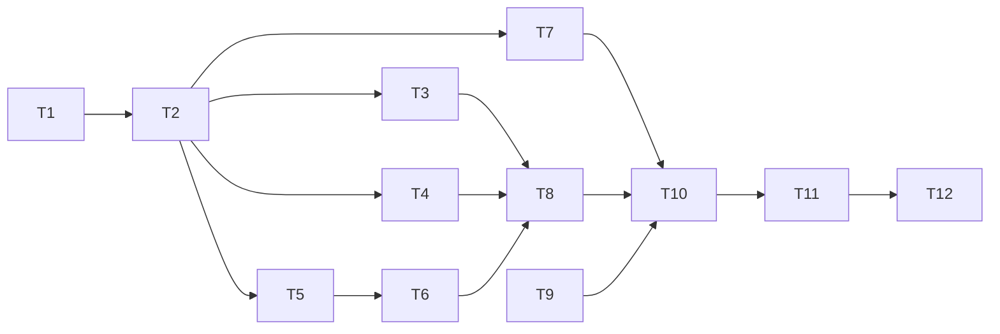

# 实施计划：5.0.0

> 写于 2026-10-26。依据：[requirements.md](requirements.md)、[architecture.md](architecture.md)（第 13 节是实施前评审和过渡方案）、[CONTEXT.md](../CONTEXT.md)。
> 状态：**草稿，Issues 尚未发布**。发布后，任务状态以 GitHub Issues 为准，本文只保留里程碑和链接。
> 下面列出的命令都是计划中的验收方式，没有执行过。

## 首个可开工任务

**T1 重构：统一“是否公开”和 front matter 的解析**，建议档位：标准。新开会话，用 `task-implement` 指定 T1（发布后改为指定对应的 Issue）。T9 也不依赖其他任务，但要先和作者约好暂停 Obsidian Git 的时间。

## 里程碑

| 里程碑 | 交付的能力 | 需求 | 线上网站 |
| --- | --- | --- | --- |
| M1 新流水线骨架 | 用真实内容（旧文件夹布局）在临时目录里构建出新版文章页，链接和图片可用 | R-PUB-1～3、R-PUB-5 | 不变 |
| M2 读者页面 | 预览站点具备首页、全部文章、完整文章页、系列、跳转页和手机版式 | R-UI-1～6、R-PUB-4 | 不变 |
| M3 切换上线 | 内容迁移到新文件夹，线上换成新网站，旧流水线删除，5.0.0 记录完成 | R-STR-1～5、R-CLN-1～3、全部验收 | 切换 |

## 任务一览

| ID | 任务 | 里程碑 | 依赖 | 档位 | 状态 |
| --- | --- | --- | --- | --- | --- |
| T1 | 重构：统一“是否公开”和 front matter 的解析 | M1 | 可立即开工 | 标准 | 可执行 |
| T2 | 新流水线骨架：预览构建生成文章页 | M1 | T1 | 强 | 可执行 |
| T3 | 首页与顶部栏 | M2 | T2 | 标准 | 待细化 |
| T4 | 全部文章页与筛选 | M2 | T2 | 标准 | 待细化 |
| T5 | 文章页：信息、目录、上下篇、评论、复制、公式 | M2 | T2 | 标准 | 待细化 |
| T6 | 系列博客 | M2 | T5 | 标准 | 待细化 |
| T7 | 跳转页与 404 | M2 | T2 | 标准 | 待细化 |
| T8 | 版式、手机适配和深色模式 | M2 | T3、T4、T6 | 标准 | 待细化 |
| T9 | 删除笔记、归档和转发脚本 | M3 | 可立即开工（需约作者） | 强 | 待细化 |
| T10 | 迁移文件夹并切换到新流水线 | M3 | T7、T8、T9 | 强 | 待细化 |
| T11 | 删除旧流水线 | M3 | T10 | 标准 | 待细化 |
| T12 | 5.0.0 线上验收与记录 | M3 | T11 | 标准 | 待细化 |

T2 完成后，T3、T4、T5、T7 互不依赖，可以并行，但都会改 `tools/render.py` 和 `theme/`，并行时需要各自的 worktree，并按 T3 → T4 → T5 → T7 的顺序合并。T9 可以和 M1、M2 任何任务并行。

检查点：T2 完成后，作者打开一次预览站点确认方向；T8 完成后，作者在手机和桌面上过一遍 M2 的全部页面，再进入 T10。

## M1 任务（可执行）

### T1 重构：统一“是否公开”和 front matter 的解析

**目标**：为新流水线做准备、不改变线上网站的重构。新建 `tools/content.py`，放 `Stage`、`Layout`、`LAYOUT`、`is_published`、`read_meta`（接口见 [architecture.md §4.1](architecture.md)）。转换器和网址分配改为接收调用方给的判断函数，不再自己认 `UNPUBLISHED_PATHS` 和一级文件夹；slug 和其他元数据统一用 YAML 读取。旧的 `build_site.py` 继续按 4.1.0 的规则传入判断函数，构建出的网站与改动前逐字节相同。对应 R-PUB-2、R-PUB-5 的前置工作。

**涉及范围**：`tools/content.py`（新）、`tools/obsidian_compat/converter.py`、`tools/obsidian_compat/urls.py`、`tools/site_nav.py`、`tools/build_site.py`、`tests/test_content.py`（新）、`tests/test_compat.py`、`tests/test_urls.py`、`tests/test_site_nav.py`。

**依赖**：可立即开工

**建议档位**：标准 — 机械重构，接口已在架构文档写定，验收是“输出不变”。

**参照**：
- `Converter.__init__(index, unpublished_paths)` 和 `is_unpublished`（`converter.py:127-132`，唯一使用处在 `converter.py:541`）改为 `Converter(index, is_published: Callable[[Path], bool] = lambda path: True)`；现有测试 `test_compat.py:72` 用 `("私密",)` 的地方改成对应的函数。
- `plan_page_urls(docs, pages, is_unpublished, sections)`（`urls.py:48`）改为 `plan_page_urls(docs, pages, is_published, prefix_of: Callable[[Path], str | None])`，`prefix_of` 返回 `None` 时照旧报 `E_URL_SECTION_MISSING`。
- `front_matter_slug` 改为用 `content.read_meta` 取值，只自己扫描行号；`site_nav.read_meta` 删除，调用方改用 `content.read_meta`。
- `content.is_published(path, layout)`：按 `Stage.folder` 最长前缀匹配，`index.md` 恒为公开，`.obsidian` 下的文件不公开。
- 边界用例：`slug: abc # note` 读成 `abc`；front matter 未闭合时读不到 slug（4.1.0 能读到，这是有意的行为变化，真实内容里没有这种页面，由下面的“输出不变”验收确认）；`Layout` 里 `03思考` 和 `03思考/初稿` 同时存在时，`03思考/初稿/a.md` 属于后者。

**验收**：
- [ ] 测试：`.venv/bin/python -m unittest discover -s tests`
- [ ] 构建：`.venv/bin/python tools/build_site.py` 输出 `build succeeded: …`，页数与改动前相同
- [ ] 输出不变：改动前后各构建一次，把 `site/` 分别复制到临时目录，`diff -r` 没有差异；比较完删除临时目录和 `site/`

### T2 新流水线骨架：预览构建生成文章页

**目标**：第一个端到端切片。`Catalog.load` 读出全部文章（标题、阶段、日期、标签、简介，按 `createdDate` 从新到旧，缺日期的排最后并给出 `W_POST_DATE_MISSING`），`render.write_site` 把每篇文章渲染成 `<阶段前缀>/<slug>/index.html`：站内 `.md` 链接改写成相对网址并保留锚点，图片复制到 `assets/` 并正确显示。先只用最简单的 `base.html`、`article.html` 和一份基础样式。临时入口 `tools/preview_v5.py <输出目录>` 用旧文件夹布局的 `Layout` 构建真实内容，跑 `check_site`，有诊断就以非零退出。对应 R-PUB-1、R-PUB-2、R-PUB-3、R-PUB-5。

**涉及范围**：`tools/content.py`、`tools/render.py`（新）、`tools/preview_v5.py`（新，T11 删除）、`theme/templates/base.html`、`theme/templates/article.html`、`theme/assets/site.css`（新）、`site.toml`（新）、`requirements.txt`（显式加入 `Jinja2==3.1.6`、`PyYAML==6.0.3`）、`tests/test_content.py`、`tests/test_render.py`（新）。不改 `build_site.py`。

**依赖**：依赖 T1

**建议档位**：强 — 首个端到端骨架，定下 `Catalog` 和 `write_site` 两个跨模块接口。

**参照**：
- 接口以 [architecture.md §4.1、§4.3、§5](architecture.md) 为准；`write_site` 的 `urls` 用 `plan_page_urls` 的结果（键是源路径的 POSIX 字符串），实现时如果改成 `Path` 键，同步改架构文档。
- 旧布局：`Stage("03思考", "思考", "thoughts")`、`Stage("03思考/初稿", "初稿", "drafts")`、`Stage("04技术", "博客", "blog")`、`Stage("05作品", "作品", "opus")`，`series` 先留空（T6 再加）。
- 现有可借鉴的实现：日期和标签的解析在 `site_nav._as_date`、`_as_tags`；附件发布规则在 `build_site._copy_and_convert`，新规则只复制公开文章引用到的附件；HTML 检查用 `obsidian_compat.html_check.check_site`。
- Markdown 扩展照搬 `mkdocs.yml` 的 `markdown_extensions`，另加 `toc`、`tables`、`fenced_code`。
- 边界用例：公开文章链接到不公开页面时显示纯文字；链接到本页标题 `[[#标题]]`；附件文件名含空格和中文；`docs/index.md` 不生成文章页。

**验收**：
- [ ] 测试：`.venv/bin/python -m unittest discover -s tests`
- [ ] 构建：`.venv/bin/python tools/preview_v5.py <临时目录>` 退出码 0；`.venv/bin/python tools/build_site.py` 仍然成功（线上不变）
- [ ] 手工验证：`.venv/bin/python -m http.server -d <临时目录> 8000`，打开《CLANNAD》→ 双链能点、目标正确，图片显示；`<临时目录>` 里没有 `00收集`、`01系统`、`02笔记`、`07自己`、`09归档` 任何一篇的页面。验收后删除临时目录

## M2、M3 任务（待细化）

细化时补全涉及范围、参照和验收命令，并复核档位。

- **T3 首页与顶部栏**（R-UI-2、R-UI-3）：`home.html`、顶部栏两项、`Catalog.home()`、作者的话来自 `docs/index.md`、末尾“全部文章”入口。验收看需求第 7 节对应两行。
- **T4 全部文章页与筛选**（R-UI-4）：`/posts/`、`posts.html`、`site.js` 的阶段和标签筛选、查询参数、空结果提示；没有 JS 时列表全部可见。
- **T5 文章页**（R-UI-5）：日期、阶段、标签；二、三级标题合计 ≥ 3 时显示目录；同阶段按日期的上一篇 / 下一篇；Giscus（参数从 `mkdocs.yml` 的 `extra.giscus` 搬到 `site.toml`）；代码复制按钮；只在有公式的页面加载 MathJax `3.2.2`。
- **T6 系列博客**（R-UI-6，架构 §6）：`Layout.series`、`E_SERIES_UNCONFIGURED`、`E_SERIES_ENTRY_MISSING`、`E_STAGE_SUBFOLDER`、阅读顺序沿用 `site_nav._reading_order`、文章页的系列导航、全部文章页的系列名、首页排除系列子文件夹。
- **T7 跳转页与 404**（R-PUB-4，架构 §5）：`REDIRECTS` 解析目标网址、`E_REDIRECT_TARGET_MISSING`、`E_REDIRECT_CONFLICT`、`404.html`。预览里验证 `/tech/subscribe-claude-quick/` 跳到 `/blog/subscribe-claude-quick/`。
- **T8 版式、手机适配和深色模式**（R-UI-1、第 6 节手机优先）：参考刘未鹏博客的单栏版式；375px 下三种页面无横向滚动，表格、公式、代码块在容器内滚动；`prefers-color-scheme` 深色。用浏览器在 375px 和桌面宽度下检查。
- **T9 删除笔记、归档和转发脚本**（R-CLN-1～3）：在 4.1.0 流水线上做，线上随之去掉笔记。删除 `docs/02笔记`、`docs/09归档`、只被它们引用的附件和 `scripts/setup.sh`；其他页面指向被删页面的双链改成纯文字（保留显示文字）；`build_site.py` 去掉 `NAV_NOTES` 和这两个文件夹的前缀；`AGENTS.md` 去掉 `setup.sh` 的说明。删除前把附件清单和改写的双链清单写进提交说明。开始前请作者暂停 Obsidian Git，推送后在 Obsidian 拉取。
- **T10 迁移文件夹并切换到新流水线**（R-STR-1～5、R-PUB-1、R-PUB-2、R-PUB-4）：一次提交完成——`git mv` 迁移到新文件夹、改写双链、合并 `00收集/灵感`、重写 `docs/01系统/分类标准.md`、`build_site.py` 改用 `content.LAYOUT` 和新渲染层、`tests/test_repository.py` 加结构检查（架构 §10）、更新 `AGENTS.md` 的“项目说明”。同样要先请作者暂停 Obsidian Git。验收：需求第 7 节 M1～M3 的各行，加上推送后线上访问 `/tech/subscribe-claude-quick/`。
- **T11 删除旧流水线**（架构 §8 的删除清单）：`mkdocs.yml`、`overrides/`、`theme/extra.css`、`docs/javascripts/`、`tools/site_nav.py`、`tools/preview_v5.py`、`PageUrlPlugin`、`renamed_folder_redirects`、`requirements.txt` 里的 `mkdocs` 和 `mkdocs-material`，以及对应的测试。
- **T12 5.0.0 线上验收与记录**：按需求第 7 节逐行在线上验收；`开发文档/DEVELOPMENT.md` 写 5.0.0 条目（不兼容：文件夹、网址、前端）；把 README 过时段落的清单（架构 §12）交给作者。可以用 `project-delivery` 执行。
